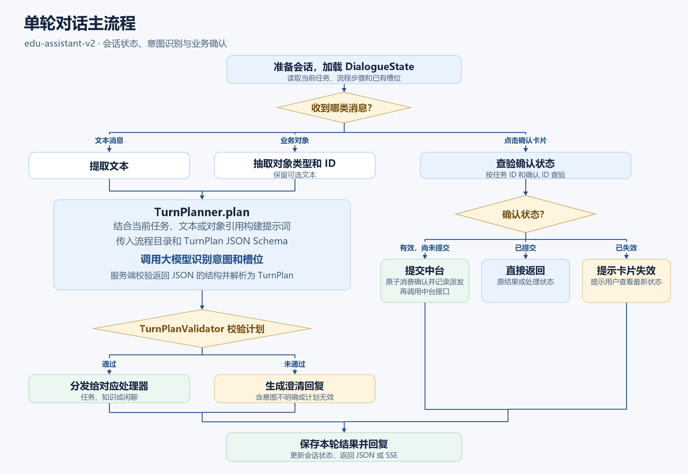
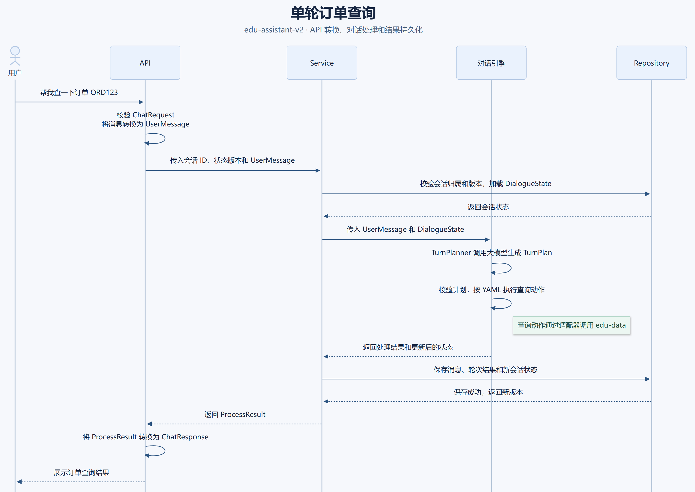

# 教育智能客服系统主流程文档

> 2026-11-19 · 实现设计稿。阅读范围：本文保留原确认派发设计作为后续方案，不作为当前售后链路。当前退款、工单在收集后进入 `handoff`，返回白名单业务入口卡，客服没有事务 B 或中台写入动作。实际启动与交付边界见 [README](../README.md)，待用户手动验收。

## 1. 主线与职责



参考 `customer_service0708` 的 `chat_router.chat → DialogueService.run → DialogueRepository.load_state → DialogueEngine.process_message → DialogueRepository.save_state`。v2 沿用入口、编排、引擎和仓储的职责划分，保留 `TurnPlanner → TurnPlanValidator → 处理器`；不沿用按 `sender_id` 覆盖唯一快照的落库方式。一个用户可有多个会话，每条请求有独立轮次与消息；写操作新增结构化确认分支。

| 层 | 在主流程中的职责 |
| --- | --- |
| API | FastAPI 校验身份和 DTO，转换为 `UserMessage`，调用 Service，将 `ProcessResult` 转成 JSON 或 SSE。 |
| Service | 受理、去重、版本与租约检查、调用引擎、协调确认派发及事务；不把数据库连接交给模型。 |
| Engine | 解析文本或业务对象、生成与校验计划、分发处理器。确认消息走确定性逻辑，不调用模型。 |
| Repository | 用 SQLAlchemy 访问 MySQL；管理快照、轮次与消息的原子读写。`SessionState` 即技术方案流程图中的对话状态。 |
| 中台适配器 | 按注册动作调用 `edu-data`，提供结构化事实与归属核验；不直接读写中台数据库。 |

启动时用 FastAPI lifespan 装配数据库会话工厂、HTTP 客户端、引擎及共享 `FlowCatalog`。按技术方案使用 SQLAlchemy + PyMySQL；PyMySQL 是同步驱动，同步数据库工作单元不能阻塞异步路由事件循环，不直接照搬参考项目的异步驱动初始化。依赖注入仅提供对象，不保存跨轮状态。

## 2. API 入口与 T00 新建会话

浏览器经同源 `/api/assistant` 代理访问后端，v2 自身前缀为 `/api/v1/chat`。正式环境由认证上下文确定 `userId`；只有显式开启演示模式时才接受 `X-User-Id` 作为身份。所有会话、轮次、消息查询先核验会话归属，身份不从请求正文或模型结果取得。

| 方法（相对前缀） | 请求 | 返回给前端 |
| --- | --- | --- |
| `POST /sessions` | `{ "title": "学习咨询" }` | `sessionId, title, stateVersion, createdAt` |
| `GET /sessions` | `cursor, limit` | 本人会话分页：`items, nextCursor, hasMore` |
| `POST /sessions/{sessionId}/messages` | `clientMessageId, expectedStateVersion, stream` 与下列扁平消息字段 | JSON 或 SSE。新请求只落在指定会话，不自动迁移。 |
| `GET /sessions/{sessionId}/messages` | `cursor, limit`，可传 `clientMessageId` 定位原轮 | 按稳定顺序分页；定位时以同一 `turnId` 返回用户消息及已落库的助手回复。 |
| `GET /sessions/{sessionId}/state` | 无正文 | `stateVersion, processing, activeTask, suspendedTasks, pendingSubmissions` 等前端状态投影。 |

T00 路径：`前端 createSession → API 校验 title 和身份 → SessionService.create_session → Repository.insert_session → COMMIT → 返回 Session`。新会话生成服务端 ID，状态版本从 `0` 开始，快照初始化为空任务、空挂起栈，设置初始活动时间；仅写 `chat_session`，不调用模型或中台，也不创建空轮次和消息。提交失败不返回创建成功。列表、状态、历史读取不续期。

消息类型以 `type` 区分，业务对象不是整份业务数据：

| `type` | 专属字段 | 入口处理 |
| --- | --- | --- |
| `text` | `text` | 非空，按长度限制校验；用于规划。 |
| `business_object` | `object: { kind, id }`，可选文本 | 只接受已支持的类型与可精确表示的正整数 ID；转换为对象引用，不信任页面内容。当前前端发送的类型为 `order / cohort / order_item / refund_request`；配置中的 `series` 对象不是当前前端联调入口，课程可用关键词。 |
| `confirmation` | `confirmation: { taskId, confirmationId }` | 只传定位标识，不接受金额、用户或订单明细等提交参数；文本“确认”不能替代卡片。前端“取消当前任务”当前仍走文本入口。 |

例如新会话发起订单查询：

```json
{
  "clientMessageId": "c21b1d1a-3e30-4c35-87c1-7e04f1b1f97f",
  "expectedStateVersion": 0,
  "type": "text",
  "text": "帮我查下订单 ORD0000000001",
  "stream": false
}
```

## 3. 从受理到生成本轮结果

### 单轮订单查询时序图

以订单号已提供的查询为例，图中展示从 API 接收消息、Service 加载状态、对话引擎查询 `edu-data`，到 Repository 保存结果并返回前端的调用顺序。图中的 `DialogueState` 在本文中对应持久化的 `SessionState`。



图中的两次 Repository 调用分别对应下文的**事务 A（受理并保存用户消息）**和**事务 C（保存回复并更新会话状态）**。模型及中台调用在事务之外；事务 C 提交成功后才返回最终 JSON 或发送 SSE `done`。订单查询不写中台，因此不经过事务 B；退款和工单在确认后才走事务 B，先记录派发，再调用中台。

### 3.1 受理：短事务 A

1. API 校验后，Service 以用户身份锁定目标会话行（或使用等价的条件更新），先按 `(session_id, client_message_id)` 查原轮。首次接收时保存规范化载荷摘要，包含消息内容及原 `expectedStateVersion`；`stream` 仅影响交付，不参与业务去重。
2. 同 ID 同载荷：已结束则回放原轮持久化结果；仍在处理则返回原轮处理状态并引导查历史/状态，不建新轮。同 ID 不同载荷返回 `IDEMPOTENCY_CONFLICT`。先去重再检查当前版本与过期，避免成功轮次的断线重试被旧版本误拒。
3. 新 ID：如连续 60 分钟无有效用户交互，旧会话过期，结束未派发任务、作废旧确认，保留消息和已派发记录，返回 `SESSION_EXPIRED`；前端下次发送创建新会话。否则检查 `expectedStateVersion`；不匹配返回 `STATE_VERSION_CONFLICT` 并引导刷新。已有运行租约时不创建并行轮次，可先读现有处理状态。
4. 新轮获准后，建立 `turnId/traceId`，记录本轮基准版本和会话租约，写入 `chat_turn` 及一条用户 `chat_message`，更新有效交互时间，提交并释放数据库锁。反序列化快照交给引擎；模型和中台 HTTP 均不放在事务内。重放、未受理请求、后台核对不更新活动时间。

### 3.2 文本与业务对象：识别、校验、分发

1. `DialogueEngine.process_message` 读取当前任务、执行步骤、已填槽位与必要的近期历史。文本提取内容；对象提取 `kind/id` 和可选文本，再共用 `TurnPlanner.plan`。
2. Planner 使用 LangChain、Jinja2 和 `configs/prompts/turn_plan.schema.json` 请求结构化计划。Schema 校验和反序列化后，再由 Validator 检查轨道、命令、流程/任务引用、可填槽位、对象类型和数据来源。`task / knowledge / chitchat` 至多选一；全空是合法的澄清信号，不是可执行计划。输出格式错误、多轨或不合法命令不得执行；对意图不清给澄清，对上游超时给服务不可用提示。
3. `task` 交给 `TaskHandler`：应用合法的 `start_flow / set_slots / cancel_task / resume_task` 后推进 YAML 的 `entry → collect → action → confirm → end` 中实际存在的步骤。缺槽停在原步骤并追问，多匹配时给可核验选项；只允许已注册动作。`source: action` 的槽位只能由受信动作写入，不能由模型直接填入。对象引用在使用前核验类型、归属和关联；金额按十进制定点数规范化。
4. `knowledge` 查已审核的 FAQ 或知识文件，`chitchat` 交给闲聊处理器。合法补槽优先推进当前任务；政策、联系方式等插问或闲聊不切换任务。明确开启另一多轮任务才挂起当前任务；新任务结束后恢复最近挂起任务，保留其独立槽位并重新核验动态数据。取消只结束尚未派发的任务并作废确认，若有挂起任务则恢复；取消指向不清先澄清，不能撤销已提交的中台业务。
5. 引擎产出回复、卡片及变更后的 `SessionState`。知识、闲聊、澄清和缺槽追问也走统一入库；没有业务写动作，不等于没有轮次记录。

### 3.3 点击确认：短事务 B 与单次派发

在普通任务运行到 `confirm` 时，先核验业务引用，生成卡片与确认快照，随该轮结果提交。快照绑定会话、用户、任务、流程版本、确认 ID、有效期及完整提交参数。关键槽位变化、取消、超时或恢复后动态核验不再通过时，作废旧确认；需要时生成新卡片。

- **有效且未派发**：写入口开关、业务引用和确认仍有效时，短事务 B 条件消费确认并写入当前 `chat_turn` 的派发标识与请求记录；以确认 ID 保证只消费一次。提交 B 后才能调用中台；出站字段仅从确认快照和服务端规则组装，禁止客户端或自动重试重发 POST。
- **已经派发**：相同 `clientMessageId` 回放原轮；若使用新 ID 且通过正常受理，确认处理器按原确认返回已存结果或当前处理状态，绝不再 POST；新 ID 若版本过旧，按入口版本冲突处理。
- **已失效或不匹配**：只提示卡片失效或查看最新状态，不发送中台请求；正常受理的新轮记录该回复。
- **中台返回**：明确成功记录业务编号及状态，明确拒绝记录业务失败；若超时、断连或崩溃导致结果无法确认，记为 `unknown`（或由过期的派发中记录恢复为未知）。只允许用可靠标识只读核对；即使进程在记录派发后、实际发出前崩溃，也不能盲目补发。当前缺少可靠核对接口，保留未决并引导人工核实，不推测失败或成功。

### 3.4 统一入库：短事务 C，再响应

Repository 以本轮租约令牌和预期会话版本作条件写入，防止租约过期的旧执行者覆盖新状态：同一事务内追加助手 `chat_message`（正文和卡片），更新 `chat_turn` 的处理结果、响应快照及中台状态，并写回 `chat_session` 的最新快照、推进 `state_version`、释放该轮租约。成功提交后才可视为完成；提交失败回滚，不发完成事件。若此前已提交 B，派发记录仍在，恢复只核对原调用，不重新提交。

- JSON 响应沿用前端读取的 `sessionId, turnId, messageId, reply, cards, stateVersion`，可附 `activeTask, suspendedTasks, processing, traceId`；卡片采用 `{ type, data }`。
- SSE 用 POST + Fetch：受理后可发送 `meta`（含 `turnId`）和 `progress`；回复落库后发送 `delta(text)`，最后 `done`（含最终消息 ID、回复、卡片、状态版本）。流开始后的失败用 `error`，不伪造 `done`。前端断流不等于取消已受理轮次或中台业务，恢复时先按原 `clientMessageId` 查历史和状态；必要时重发原请求，不换 ID。
- 进程异常后由恢复逻辑处理超时轮次：未记录派发的轮次可收尾为可解释的失败，或按受控恢复策略接管原轮；已记录派发的轮次转未知并只读核对。接管/收尾必须更换或校验租约令牌，不能让旧执行者提交；后台核对不续期，也不复活过期任务。

## 4. 五类业务的中台动作

下表省略 `/api/v1`；个人数据按当前用户身份调用。适配器同时检查 HTTP 与中台响应的 `code`，将未找到、无权限、业务拒绝、暂时不可用区别处理。

| 流程 / 动作 | 入参、接口与出参边界 |
| --- | --- |
| `course_query / query_courses` | `course_keyword` 调 `GET /series?keyword=…`，或用已支持且已校验的 `series_id`；再查 `GET /series/{series_id}` 和 `GET /series/{series_id}/cohorts`。返回 `course_list`；不猜测销售状态、价格或可报名性。 |
| `order_query / query_order` | 文本订单号用 `GET /orders?pageNo=…&pageSize=…` 在本人列表中分页精确匹配 `orderNo`；已有订单 ID 则查 `GET /orders/{order_id}` 校验归属并读取状态、金额及支付摘要。输出 `order_detail`；不把 `orderNo` 当内部 ID，也不补造报名明细。 |
| `learning_progress / query_learning_progress` | `GET /me/cohorts` 解析本人班次，匹配不唯一时追问；`GET /me/cohorts/{cohort_id}/progress` 与 `GET /me/exams?cohortId=…` 获取记录。输出 `learning_progress`；没有权威应学分母时仅展示已有记录。 |
| `refund_apply / resolve_order_item → submit_refund` | 收集订单、原因、类型、申请金额；权威核验订单明细后确认。`POST /order-items/{order_item_id}/refund-requests`，将快照映射到 `refundType, refundReason, applyAmount`，成功展示 `refundRequestId, refundNo, refundStatusCode`，只表示申请已受理，不等于实际退款。 |
| `ticket_create / resolve_ticket_links → submit_ticket` | 收集类型、订单和描述；`GET /me/student-profile` 查 `studentId`，核验本人订单明细；退款类另查 `GET /refund-requests/{refund_request_id}` 并核验其关联同一订单明细。确认后 `POST /service-tickets`，发送 `ticketType, ticketContent, studentId, orderItemId` 及适用的 `refundRequestId`，`ticketSource=customer_service`，`title/priorityLevel` 由服务端规则提供。成功展示 `ticketId, ticketNo, ticketStatus`，不编造 SLA。 |

当前中台公开契约未提供权威订单明细列表/关联字段，退款详情也未返回订单明细关联；收到明细或退款卡片仍不能跳过核验。缺失时停在解析/核验步骤，不生成可提交确认。中台也尚未提供按客服提交标识可靠核对的接口，真实退款及工单写入首版默认关闭；资格、审批、业务幂等及最终业务入库仍由中台承担。

## 5. 三表逻辑契约

下表为业务字段/约束建议，不宣称是已有 DDL。需求说明记录三表已手工创建；开发时先按已有表结构做 ORM 映射及确认差异，不在本文新增建表脚本或执行数据库取证。

| 表 | 逻辑字段 | 写入与约束 |
| --- | --- | --- |
| `chat_session` | 会话 ID、用户 ID、标题、状态版本、`SessionState` JSON、最后有效交互时间、过期标记、处理租约。快照含活跃任务、挂起栈、各自的流程 ID/版本、步骤、已校验槽位和确认引用/快照。 | 创建会话插入；A 记录活动与租约，B 消费确认，C 更新快照和版本。本人会话按稳定顺序查询。重启从快照恢复，不依赖内存单例。 |
| `chat_turn` | 轮次 ID、会话 ID、客户端消息 ID、载荷摘要、基准版本、处理状态、最终响应快照、追踪 ID；写动作另存确认/提交标识、派发状态、核对线索和中台业务编号。 | `(session_id, client_message_id)` 唯一；A 插入，B 记录单次派发，C 保存最终回复及状态。轮次处理和业务派发是两个状态维度：轮次可已回复，业务结果仍可未知。 |
| `chat_message` | 消息 ID、会话与轮次 ID、顺序号、角色、消息类型、正文/结构化引用、卡片 JSON、时间。 | A 写用户，C 写助手；首版同轮每种角色最多一条。历史用稳定顺序游标；按客户端消息 ID 先定位轮次，不靠文本猜测。 |

流程与知识用版本化文件，不增加业务表；诊断日志使用 `traceId / sessionId / turnId` 关联，脱敏文本、订单引用和身份数据，不记录凭证、完整提示词或原始中台载荷。


## 6. 可先提取的方法

以下是实现接缝，用来先定边界再补能力，不要求一次搭齐。请求/响应指 FastAPI DTO；执行结果和快照为领域对象。示例签名省略依赖参数和具体类型。

| 层 | 建议方法 | 单一职责 / 参考来源 |
| --- | --- | --- |
| API | `build_user_message(request) → UserMessage`、`build_chat_response(result) → ChatResponse` | 扁平 DTO 与领域对象转换；对应参考 `chat_router._build_user_message / _build_response_message`。 |
| 会话 Service | `create_session(user_id, title)`、`get_state(user_id, session_id)` | T00 创建空会话；状态读取将快照、轮次和未决派发映射给前端。 |
| 单轮 Service | `run(user_id, session_id, message, request_meta) → ProcessResult` | 调用受理、引擎、确认派发及完成事务；对应参考 `DialogueService.run`，不跨远程操作持有事务。 |
| Repository | `insert_session(...)`、`begin_turn(...) → TurnAdmission`、`finish_turn(...) → ProcessResult` | 对应 T00、事务 A、事务 C；`TurnAdmission` 区分新轮、重放、处理中与拒绝，避免在路由中拼 SQL 或分散提交。 |
| Repository | `claim_confirmation(...) → DispatchClaim`、`list_history(...)` | 前者在事务 B 原子确认与记账，后者支持游标及原轮查询；仅成功取得派发权才允许发 POST。 |
| 状态编解码 | `load_snapshot(raw) → SessionState`、`dump_snapshot(state)` | 复用参考仓储 JSON 序列化思路，校验快照结构；恢复时按任务绑定的流程版本查目录。旧版本缺失不静默改跑新版。 |
| 规划与校验 | `TurnPlanner.plan(state, message)`、`TurnPlanValidator.validate(plan, state, message)` | 前者只产生候选，后者按目录、状态与输入事实校验；不直接发业务请求。 |
| 任务推进 | `TaskHandler.handle(plan, state)`、`FlowExecutor.advance(state)` | 对应参考 `TaskHandler.handle / FlowExecutor.executor`；复用槽位收集、步骤推进与确认停点。`FlowCatalog` 启动时统一校验槽位、步骤引用、动作注册和版本。 |
| 对象核验与动作 | `resolve_business_object(user_id, ref)`、`ActionRunner.run(action_id, context)` | 白名单解析与归属/关联核验；注册表分发；写动作需要持久化的派发许可。 |
| 传输 | `iter_sse_events(result_or_progress)` | 只映射事件，不触发第二次处理；`done` 依据已提交结果生成。 |

建议实现顺序：**T00** 先写 API 映射、`create_session` 与 `insert_session`；**T00b** 五类 YAML 已有配置稿，随后实现目录加载、校验和任务执行；再接事务 A/C、两轮订单查询和历史恢复，最后在中台能力满足后接事务 B 及写动作。

## 7. 最小联调走查

以一个新会话为例，每轮使用不同的 `clientMessageId`：

| 操作 | 预期行为与持久化结果 |
| --- | --- |
| 前端创建会话 | 一条 `chat_session`，版本 `0`，无轮次、无消息。 |
| 发送“帮我查一下订单”（版本 `0`） | 启动 `order_query`，在 `collect_order` 追问；一条轮次、两条消息，快照版本 `1`，保留任务。 |
| 刷新或重启服务，读取历史和状态 | 读回追问、任务步骤和版本 `1`，不新增轮次、不续期。 |
| 发送本人订单号（版本 `1`） | 补齐 `order_number`，查本人订单列表与详情；保存订单卡片和结束后的快照，版本 `2`。 |
| 第二轮 SSE 在 `done` 前断开 | 按原请求 ID 查历史，若未见最终结果，用原请求重放；最终仍只有两条轮次、四条消息，不重复查询已完成轮次。 |
| 写动作尚未开放或必要关联查不到 | 不发出中台 POST；未明确成功的结果不能出现成功卡片。中台能力补齐后，再手动验证重复确认、超时未知且不重发、旧确认失效。 |

以上是手动验收预期，不是测试结果。需求规定由用户完成验收，本次不运行测试或数据库取证。

**本地依据**：[教育智能客服系统技术方案](教育智能客服系统技术方案.md) · [需求说明](../../技术文档/需求说明.md) · [中台接口 README](../../edu-data/README.md) · [前端 API 适配](../../edu-web/src/api/assistant.ts) · [流程配置](../configs/flows) · [课堂参考服务](../../../teacher/customer_service0708/atguigu/service/dialogue_service.py)
