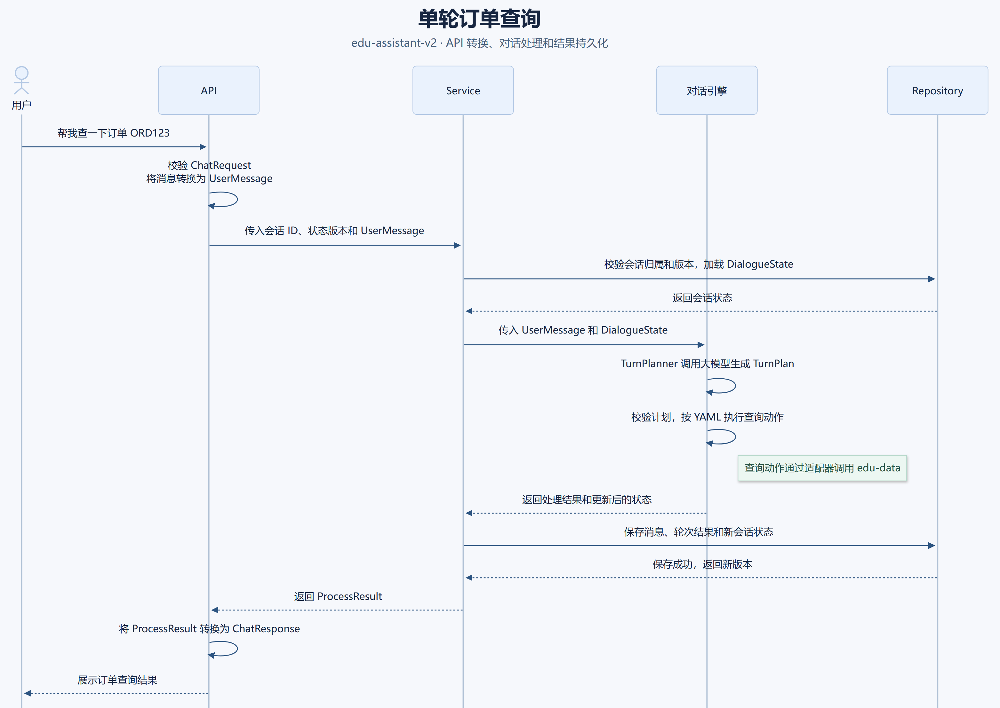
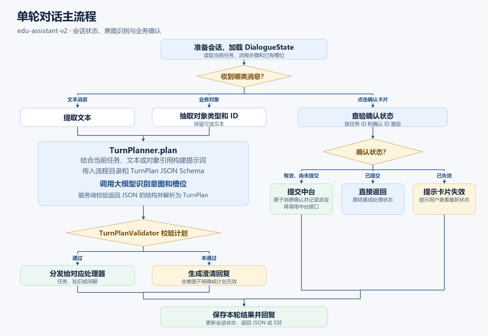

# 教育智能客服系统技术方案

初版 · 2026-11-19

首版覆盖课程咨询、订单查询、学习进度、退款与工单办理引导，以及 FAQ、知识检索、澄清和闲聊。本文以 [需求说明](../../技术文档/需求说明.md) 为业务依据，参考课堂项目和现有中台接口。当前实现按 [启动说明](../README.md) 交付，待用户手动验收。图中的确认与派发是后续设计，不属于此版写入能力。

## 1. 系统架构

| 层次 | 组件与职责 |
| --- | --- |
| 前端 | `edu-web` 使用 Vue 3、TypeScript 和 Vite。客服页展示会话、历史、任务状态与业务卡片，通过同源代理发送 JSON 或 POST SSE 请求。 |
| 对话服务 | `edu-assistant-v2` 计划使用 Python、FastAPI，内部按 API → Service → Repository 分层。API 转换请求和响应，Service 管理会话并编排单轮对话，Repository 管理状态和事务。 |
| 客服存储 | 使用 SQLAlchemy + PyMySQL 访问 MySQL。流程和知识走版本化文件，诊断轨迹写入脱敏日志。 |
| 业务中台 | `edu-data` 提供课程、订单、学习和售后 HTTP 接口。中台维护业务数据、校验业务归属和退款资格，并处理工单、退款审批及实际退款。 |

参考项目 `customer_service0708` 的主线是 `DialogueEngine → TurnPlanner → TurnPlanValidator → 处理器`。教育客服沿用该流程，文本通过 LangChain 和 Jinja2 提取结构化意图及候选槽位，对象消息提供业务引用，服务端校验后才能填槽或调用已注册动作。流程由版本化 YAML 定义，加载后形成共享 `FlowCatalog`，运行任务固定所用版本。通用步骤为 `entry / collect / action / confirm / end`。

## 2. 主时序图

以单轮订单查询为例。用户直接提供订单号，API 校验 `ChatRequest` 并将消息转换为 `UserMessage`，把会话 ID 和状态版本一并传给 Service。Service 通过 Repository 加载 `DialogueState`，交给对话引擎生成并校验 `TurnPlan`，执行查询后保存本轮结果和新状态。API 将 Service 返回的 `ProcessResult` 转换为 `ChatResponse`。



## 3. 主流程图

会话受理后，文本消息和业务对象先抽取文本或对象引用，再由 `TurnPlanner` 结合当前任务生成统一的 `TurnPlan`，交给 `TurnPlanValidator` 校验后分发。点击确认卡片时，由服务端按确认状态决定提交、返回原结果或处理状态，或提示失效。需要记录的新轮次统一保存后回复。



### TurnPlan 输出格式

`TurnPlanner` 使用包含 TurnPlan JSON Schema 的提示词调用大模型识别意图和槽位，校验返回的 JSON 结构并解析为 `TurnPlan`，再交给 `TurnPlanValidator` 校验计划。沿用参考项目的三个字段，每轮恰好选中一个轨道，其余字段填 `null`。

| 字段 | 选中时的内容 |
| --- | --- |
| `task` | `{"commands": [...]}`，例如开启流程、给当前任务补槽、恢复或取消任务。 |
| `knowledge` | `{"intents": [...]}`，使用知识目录中的意图 ID。 |
| `chitchat` | `{}`，表示走闲聊处理器。 |

三个字段全为 `null`、有多个字段非 `null`，或选中 `task` 但 `commands` 为空时，`TurnPlanValidator` 判定计划无效，转入澄清。意图明确但业务槽位缺失时，任务仍可启动，由 YAML 流程追问。

例如，当前退款任务正在等待退款原因，用户回复「重复购买了」，模型返回以下补槽计划。

```json
{
  "task": {
    "commands": [
      {
        "command": "set_slots",
        "slots": {
          "refund_reason": "重复购买"
        }
      }
    ]
  },
  "knowledge": null,
  "chitchat": null
}
```

业务对象先抽取类型、ID 和可选文本，再与文本消息共用 `TurnPlanner` 的模型识别流程。处理器在使用对象引用前核验归属。点击确认卡片时，服务端根据任务 ID 和确认 ID 校验快照。

### 新增功能改哪里

| 新增内容 | 扩展位置 |
| --- | --- |
| 同类业务流程，例如调整上课班次 | 在版本化 YAML 增加意图、槽位和步骤，复用现有收集、追问和确认机制。 |
| 新的中台接口 | 在中台适配器实现并注册动作，再由流程 YAML 引用。写操作沿用结构化确认和一次派发规则。 |
| 新的处理方式或消息类型 | 新处理方式注册处理器。新消息类型在入口增加解析与校验，再映射到已有处理计划或新增通用计划类型。 |

合法补槽优先推进当前任务。政策、联系方式或闲聊插问保留原任务，明确发起另一项多轮任务才挂起原任务。各任务独立保存槽位，新任务结束后恢复原任务并重新核验动态信息。明确取消时结束尚未派发的任务并作废确认，有挂起任务则恢复，指代不明先澄清。

## 4. 五类业务与中台接口

以下路径省略中台前缀 `/api/v1`。个人数据查询及写入按当前用户身份调用。

| 业务 | 对话处理与中台调用 |
| --- | --- |
| 课程咨询 | 收集关键词，查询 `GET /series`、`GET /series/{id}`、`GET /series/{id}/cohorts`，返回课程和班次。缺少权威销售状态时提示报名状态待核实。 |
| 订单查询 | 收集订单号，通过 `GET /orders` 分页精确匹配 `orderNo`，或使用已核验的订单对象 ID，再调用 `GET /orders/{id}` 返回订单、金额及支付摘要。报名课程依赖订单明细。 |
| 学习进度 | 用 `GET /me/cohorts` 匹配本人班次，再用 `GET /me/cohorts/{id}/progress` 和 `GET /me/exams?cohortId=…` 展示考勤、视频、作业及考试记录。完整应学分母缺失时按已有记录展示。 |
| 退款申请 | 收集订单引用、原因、类型和申请金额，展示摘要与退款页面入口。客服不核验退款资格，也不代提交。 |
| 工单提交 | 收集工单类型、订单引用和问题描述；退款类另收集退款申请引用。展示摘要与工单页面入口，由用户在业务页面填写并提交。 |

FAQ 和平台政策从已审核的版本化知识文件检索。业务结果、工单跟进渠道和处理时限以中台返回或已确认配置为准。

## 5. 接口、持久化与恢复

- **客服接口** · 服务端前缀为 `/api/v1/chat`。
  - `POST /sessions` 创建会话，
  - `GET /sessions` 列出本人会话，
  - `POST /sessions/{sessionId}/messages` 接收文本、业务对象和结构化确认，同路径 `GET` 读取历史，
  - `GET /sessions/{sessionId}/state` 读取当前状态。

- **三表存储** · `chat_session` 保存 `SessionState` 快照及会话版本，`chat_turn` 保存轮次、去重和中台调用状态，`chat_message` 保存消息和卡片。新轮校验 `expectedStateVersion` 并取得会话租约，远程调用在短事务之外执行，最终在短事务内提交回复、状态版本和轮次结果。
- **响应与重放** · JSON 返回完整结果。SSE 通过 POST + Fetch 接收进度，回复落库后发送文本增量与 `done`。断流后查询原轮，或以原 `clientMessageId` 和原载荷重放。同 ID 不同载荷返回冲突。
- **售后边界** · 当前版不发起中台写入。入口卡片仅使用前端白名单目标，不是确认卡、不会提交，也不会自动预填业务表单。未来若开放客服写入，必须先补齐归属、关联核验和未知结果核对接口。
- **会话过期** · 连续 60 分钟无有效用户交互即过期，保留历史，并作废未派发任务的确认。历史查看、重放和后台核对不续期，后续新消息进入新会话。

## 6. 联调与验收边界

按需求安排，T00 先完成前端 → v2 API → Service → Repository → MySQL 的新建会话闭环，T00b 编写五类业务流程 YAML。v2 具备启动入口后，按中台、v2、前端的顺序做本地联调。演示身份拟通过显式开关启用 `X-User-Id`，正式认证待接入，真实退款和工单写入默认关闭。

对话功能实现后，由用户手动验收两轮订单查询、刷新后恢复历史和 SSE 断流后查询原轮。当前中台订单详情缺少订单明细，退款查询缺少与订单明细的关联字段，且缺少按客服提交标识核对未知结果的可靠接口。退款和工单的完整验收有待这些接口能力补齐。联调参考 [中台接口](../edu-data/README.md) 与 [前端 README](../edu-web/README.md)。
